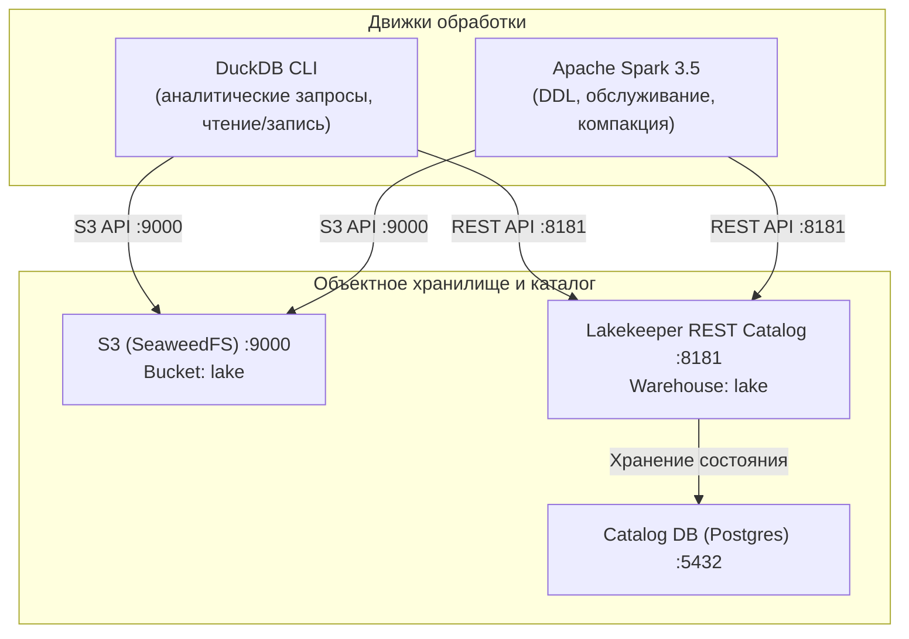

# Каталог данных платформы (Вариант 93)

# Соглашения озера (ЛР3)

- Bucket и слои: `s3://lake/raw/` — неизменяемые закрытые JSON Lines сборщика; `s3://lake/clean/events/` — очищенные Parquet. Raw хранится 63 суток (8 недель потока и 7 суток истории), clean — 63 суток; это помещается в лимит диска вместе с образами и оставляет входные данные для повторной очистки.
- Шаблон ключа: `<layer>/<dataset>/[partition=value/]<file>`. Для raw это `raw/stream/dt=ГГГГ-ММ-ДД/hour=ЧЧ/<archive>.jsonl.gz` и `raw/history/dt=ГГГГ-ММ-ДД/<archive>.jsonl.gz`; для clean — `clean/events/event_date=ГГГГ-ММ-ДД/<part>.parquet`.
- Партиции всегда UTC: `dt` — дата получения для stream и дата события для history; `hour` — час получения stream; `event_date` — дата `event_time` cleaned-события. Имена файлов raw повторяют часовой архив `gharchive-ГГГГ-ММ-ДД-ЧЧ.jsonl.gz`; clean создаёт DuckDB.
- Объект после `PUT` неизменяем, а переименования в S3 нет: сборщик загружает только закрытый файл под окончательным уникальным ключом и проверяет `head_object`, поэтому повтор не создаёт копию. DuckDB повторно записывает ту же партицию с `OVERWRITE_OR_IGNORE`.
- Листинг S3 дорог и постраничен (до 1000 ключей), поэтому читатели используют точные префиксы суток и партиции, а retention удаляет только объекты по префиксу слоя.

## raw.stream
- Архитектура и слой: файлы на диске стенда (с ЛР3 — копия в озере данных), слой сырых данных
- Где лежит: `s3://lake/raw/stream/` (первичная локальная копия: `data/raw/stream/`)
- Формат: JSON Lines, сжатие gzip (`*.jsonl.gz`)
- Партиционирование и сортировка: `dt=ГГГГ-ММ-ДД/hour=ЧЧ/` по времени получения (`received_at`, UTC); внутри файла — в порядке чтения из часового архива GH Archive
- Источник: внешний источник GH Archive (`https://data.gharchive.org/`), сборщик `collector/src/main.py` в режиме `record`
- Потребители: проверка схемы `schemas/check.py` (ЛР2), `jobs/to_parquet.sql` (ЛР2), `jobs/clean.sql` (ЛР3)
- Свежесть: обновление раз в час после публикации часового архива GH Archive, отставание 1–2 часа от реального времени
- Рост в 1000 раз: ~34 ГБ сжатых данных в сутки (превысит лимит слоя 20 ГБ за 14 часов); узкое место — однопоточная загрузка/распаковка часового архива и место на диске. Потребуется параллельная загрузка по сегментам и прямая запись в S3.

## raw.history
- Архитектура и слой: файлы на диске стенда (с ЛР3 — копия в озере данных), слой сырых данных (исторический срез)
- Где лежит: `s3://lake/raw/history/` (первичная локальная копия: `data/raw/history/`)
- Формат: JSON Lines, сжатие gzip (`*.jsonl.gz`)
- Партиционирование и сортировка: `dt=ГГГГ-ММ-ДД/` по дате события (`event_time`, UTC); внутри файла — по порядку следования событий в часовом архиве
- Источник: внешний источник GH Archive (`https://data.gharchive.org/`), сборщик `collector/src/main.py` в режиме `backfill`
- Потребители: задание `jobs/to_parquet.sql` (ЛР2), задание очистки `jobs/clean.sql` (ЛР3)
- Свежесть: загружается разово за 7 суток до начала записи потока (и при восполнении пропусков)
- Рост в 1000 раз: 7 суток среза займут ~238 ГБ сжатых данных; узкое место — объём диска стенда (100 ГБ) и последовательное скачивание 168 часовых файлов. Потребуется распределённая загрузка напрямую в S3.

## parquet.events
- Архитектура и слой: файлы на диске стенда / встраиваемый движок DuckDB, колоночный слой
- Где лежит: `data/duckdb/parquet/events/` (в контейнере `/data/duckdb/parquet/events/`)
- Формат: Parquet, сжатие snappy (в экспериментах — zstd)
- Партиционирование и сортировка: `event_date=ГГГГ-ММ-ДД` по дате создания события (`event_time`, UTC); внутри каждого файла партиции — сортировка по `event_time`
- Источник: сырые наборы `raw.stream` и `raw.history`, задание преобразования `jobs/to_parquet.sql`
- Потребители: аналитические запросы движка DuckDB (ЛР2); не используется с ЛР3 (заменяется слоем очищенных данных озера `clean.events`)
- Свежесть: формируется пакетом при запуске задания преобразования `jobs/to_parquet.sql`
- Рост в 1000 раз: ~17 ГБ сжатых Parquet в сутки (~120 ГБ за неделю среза); узкое место — файловый листинг глубокой иерархии Hive-партиций, последовательная одноузловая запись DuckDB и лимит диска. Потребуется распределенная запись (Spark) напрямую в объектное хранилище S3/Garage и скрытое партиционирование с транзакционными метаданными каталога Iceberg (ЛР3–ЛР4).

## clean.events
- Архитектура и слой: озеро данных, очищенный слой
- Где лежит: `s3://lake/clean/events/`
- Формат: Parquet, zstd; `ROW_GROUP_SIZE=122880`
- Партиционирование и сортировка: `event_date=ГГГГ-ММ-ДД` по `event_time` UTC; строки в файле отсортированы по `event_time`
- Источник: `raw.stream` и `raw.history`, задание `jobs/clean.sql` читает сырьё суток D и D+1
- Потребители: запросы DuckDB ЛР3; таблица Iceberg `lake.clean.events` (ЛР4)
- Свежесть: ежедневный запуск после появления raw за D+1; отставание до 26 часов
- Рост в 1000 раз: узким местом будут число объектов и листинг суточной партиции; потребуются почасовые партиции и компакция файлов


## lake.clean.events
- Архитектура и слой: таблица Apache Iceberg в озере данных, очищенный слой
- Где лежит: REST-каталог Lakekeeper (`http://catalog:8181/catalog`, склад `lake`), объекты в `s3://lake/`
- Формат: Apache Iceberg v2 / Parquet
- Партиционирование и сортировка: скрытое партиционирование `days(event_time)` по временной метке события; сортировка внутри файлов по `event_time`
- Источник: Parquet-слой очищенных данных озера `clean.events`, задание `jobs/iceberg_load.sql`
- Потребители: аналитический движок запросов DuckDB (`init.sql`), пакетный движок Spark SQL (`jobs/maintenance.sql`), последующие работы (витрины данных ЛР5, конвейеры ЛР7)
- Свежесть: пакетная загрузка по дням/часам с предварительным удалением периода (`DELETE WHERE event_time >= day AND event_time < day + INTERVAL '1 day'`)
- Рост в 1000 раз: листинг S3 больше не является узким местом благодаря манифестам Iceberg; при росте количества файлов в партициях применяется периодическая фоновая компакция (`CALL lake.system.rewrite_data_files`) и удаление устаревших снимков (`CALL lake.system.expire_snapshots`).

## Связи сервисов (ЛР4)



- **S3 (SeaweedFS)**: предоставляет S3-совместимое API на порту 9000 (веб-консоль на 9001). Хранит реальные Parquet-файлы данных и файлы метаданных Iceberg (`metadata/*.json`, `*.avro`).
- **Lakekeeper REST Catalog**: сервис каталога Iceberg на порту 8181, хранящий указатели на текущие версии метаданных таблиц в базе Postgres (`catalog-db`). Отвечает движкам на запросы о текущих снимках, схеме и расположении манифестов.
- **DuckDB**: используется для быстрой локальной аналитики и загрузки данных. Подключается к каталогу через расширение `iceberg` и `ATTACH 'lake' AS lake (TYPE iceberg)`.
- **Spark**: пакетный движок с расширениями `IcebergSparkSessionExtensions`. Выполняет операции DDL, обслуживание таблицы (уплотнение файлов через `rewrite_data_files`, очистку снимков через `expire_snapshots`, откат через `rollback_to_snapshot`).

## stg.events (ЛР5)
- Архитектура и слой: аналитическое хранилище ClickHouse, слой приёма (Staging)
- Где лежит: база `stg`, таблица `events` в ClickHouse (`warehouse:9000`)
- Формат: MergeTree, локальные сжатые столбцы ClickHouse
- Партиционирование и сортировка: `PARTITION BY event_date`, `ORDER BY (type, repo_id, event_time, id)`
- Источник: Parquet-файлы слоя очищенных данных `s3://lake/clean/events/`, задание `jobs/stg_load.sql` через функцию `s3()`
- Потребители: слой нормализованного ядра `core.events` (ЛР5)
- Свежесть: пакетная суточная загрузка с атомарной заменой партиции (`ALTER TABLE stg.events DROP PARTITION IF EXISTS {day:Date}`)

## core.events (ЛР5)
- Архитектура и слой: аналитическое хранилище ClickHouse, нормализованное ядро (Core)
- Где лежит: база `core`, таблица `events`
- Формат: MergeTree
- Партиционирование и сортировка: `PARTITION BY event_date`, `ORDER BY (type, repo_id, event_time, id)`
- Источник: `stg.events`, задание `jobs/mart_load.sql`
- Потребители: таблица фактов витрины `mart.fact_events`, измерение `mart.dim_actor`, расчёт SCD2 `core.dim_repo_scd`
- Свежесть: обновляется согласованно со слоем `stg`

## core.dim_repo_scd (ЛР5)
- Архитектура и слой: аналитическое хранилище ClickHouse, историческое измерение с версионированием SCD Type 2
- Где лежит: база `core`, таблица `dim_repo_scd`
- Формат: ReplacingMergeTree
- Партиционирование и сортировка: `ORDER BY (repo_id, valid_from)`
- Поля: `repo_id`, `repo_name`, `activity_class` (low/medium/high), `daily_events`, `valid_from`, `valid_to`, `is_current`
- Источник: агрегация транзакций ядра `core.events` по суткам
- Потребители: аналитическая витрина `mart.dim_repo`, запросы «как выглядели данные на дату»
- Свежесть: суточный срез; при изменении класса активности или названия создаётся новая версия записи с `valid_from = day`, прошлая закрывается `valid_to = day - 1`

## mart.fact_events (ЛР5)
- Архитектура и слой: аналитическое хранилище ClickHouse, витрина «Звезда» (таблица фактов)
- Где лежит: база `mart`, таблица `fact_events`
- Формат: MergeTree
- Партиционирование и сортировка: `PARTITION BY event_date`, `ORDER BY (type_key, repo_id, event_time, event_id)`
- Зернистость: одно событие GitHub
- Ключи измерений: `event_date`, `type_key`, `repo_id`, `actor_id`
- Метрика: `events_count = 1`
- Источник: `core.events`, задание `jobs/mart_load.sql`
- Потребители: материализованное представление `mart.mv_hourly_events`, отчёты Metabase, аналитические SQL-запросы

## mart.dim_type / mart.dim_actor / mart.dim_repo (ЛР5)
- Архитектура и слой: аналитическое хранилище ClickHouse, таблицы измерений витрины «Звезда»
- Где лежат: база `mart` (`dim_type`, `dim_actor`, `dim_repo`)
- Формат: MergeTree / ReplacingMergeTree
- Назначение: хранение справочников типов событий, уникальных акторов и репозиториев с историей изменения статусов (SCD2)
- Источник: справочные данные и проекции из `core`

## mart.agg_hourly_events и mart.mv_hourly_events (ЛР5)
- Архитектура и слой: аналитическое хранилище ClickHouse, предрассчитанный агрегат витрины
- Где лежит: база `mart`, таблица `agg_hourly_events` + материализованное представление `mv_hourly_events`
- Формат: SummingMergeTree(events_count), `PARTITION BY event_date`, `ORDER BY (hour, type_key)`
- Назначение: мгновенная отдача почасовой аналитики для интерактивных дашбордов Metabase без сканирования сырых фактов
- Источник: наполняется автоматически при вставке в `mart.fact_events` через триггер материализованного представления

## Связи сервисов (ЛР5)

```mermaid
flowchart TD
    subgraph Lake ["Озеро данных и каталоги"]
        S3["S3 (SeaweedFS / Garage) :9000<br/>s3://lake/clean/events/"]
        Catalog["Lakekeeper REST Catalog :8181"]
    end

    subgraph DWH ["Аналитическое хранилище (ClickHouse :8123 / :9000)"]
        STG[("stg.events<br/>(Слой приёма)")]
        CORE[("core.events / core.dim_repo_scd<br/>(Нормализованное ядро + SCD2)")]
        MART[("mart.fact_events + mart.dim_*<br/>(Витрина 'Звезда')")]
        MV[("mart.agg_hourly_events<br/>(SummingMergeTree MV)")]
        
        STG -->|jobs/mart_load.sql| CORE
        CORE -->|jobs/mart_load.sql| MART
        MART -->|Инкрементальный триггер| MV
    end

    subgraph BI ["Визуализация и аналитика"]
        Metabase["Metabase BI :8088<br/>(Дашборды и графики)"]
        DuckDB["DuckDB CLI<br/>(Бенчмарк путей)"]
    end

    S3 -->|s3() функция в jobs/stg_load.sql| STG
    S3 -->|read_parquet()| DuckDB
    Catalog -->|Iceberg REST| DuckDB
    MV -->|HTTP 8123 (SQL)| Metabase
    MART -->|HTTP 8123 (SQL)| Metabase
    MART -->|SQL| DuckDB
```

- **S3 $\to$ ClickHouse (`stg.events`)**: ClickHouse обращается к S3 по протоколу HTTP на порт 9000 с авторизацией через функцию `s3()`, считывая Parquet-файлы с автоматическим сопоставлением типов.
- **ClickHouse $\to$ Metabase**: Сервис `bi` (Metabase) на порту 8088 подключается к сервису `warehouse` (ClickHouse) по HTTP-порту 8123 (база `mart`, логин/пароль `student`/`student`) и исполняет аналитические SQL-запросы в реальном времени.
- **Движок DuckDB**: используется в качестве единого арбитра для сравнительного бенчмарка трёх архитектурных путей.


| `raw.topic` | Партиционированные Parquet-файлы потока Kafka | `s3://lake/raw/topic/dt=YYYY-MM-DD/hour=HH/*.parquet` | Регулярная выгрузка потребителем `sink.py` из темы `events` |
| `events` (тема) | Тема сообщений брокера Apache Kafka | `localhost:9092` / `broker:9092` (3 партиции) | Первичный поток событий с Avro-сериализацией |
| `lake.clean.events_hourly` | Почасовые агрегаты пакетного конвейера | Iceberg REST Catalog `lake.clean.events_hourly` | Пакетное задание PySpark / Dagster |
| `mart.events_hourly` | Витрина часовых агрегатов | ClickHouse `mart.events_hourly` | Аналитическая отчетность в Metabase |
| `lake.clean.events_rt` | Потоковые оконные агрегаты реального времени | Iceberg REST Catalog `lake.clean.events_rt` | Spark Structured Streaming (5-мин окна, watermark 10 мин) |
| `mart.events_rt` | Витрина реального времени | ClickHouse `mart.events_rt` | Мониторинг потока в Metabase |
