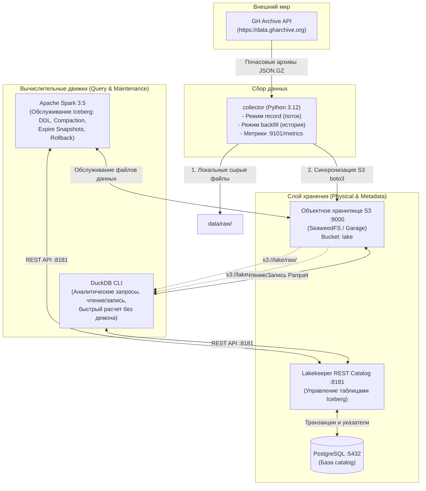
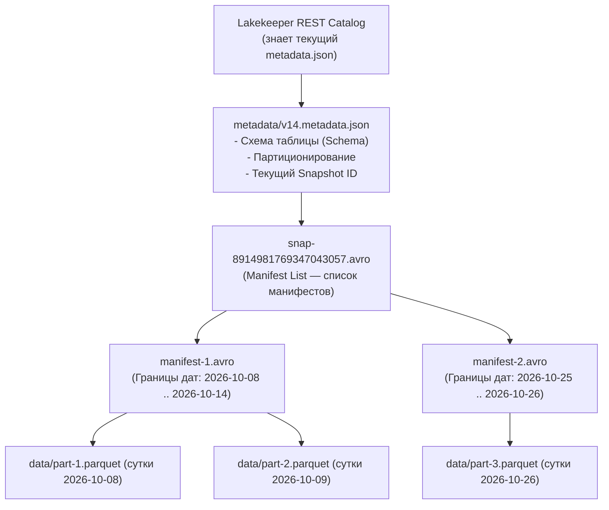
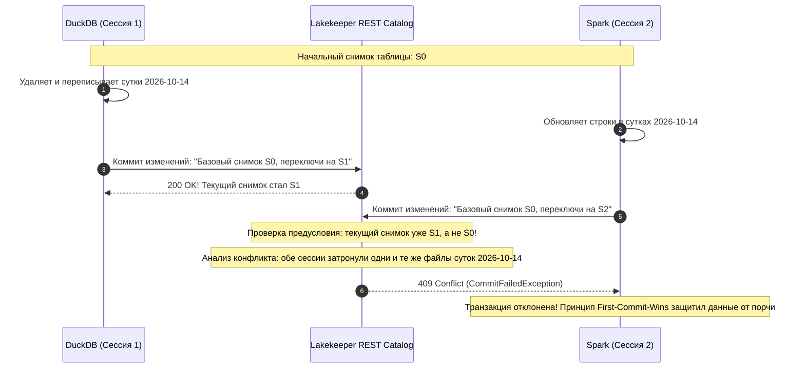

# 🚀 Полное руководство по платформе данных (ЛР1–ЛР4, Вариант 93)
> **Курс**: Технологии обработки больших данных  
> **Вариант**: №93 (GH Archive, Avro, S3/Garage/SeaweedFS, DuckDB, Spark, Metabase, Kafka, Dagster, Spark Streaming)  
> **Статус**: ЛР1–ЛР4 полностью выполнены, протестированы и готовы к защите (включая дополнительное задание ЛР4).

---

## 📑 Содержание
1. [Архитектура и иерархия системы: кто кем управляет](#1-архитектура-и-иерархия-системы-кто-кем-управляет)
2. [Ретроспектива первых трёх лабораторных работ](#2-ретроспектива-первых-трёх-лабораторных-работ)
   - [ЛР1. Стенд и сбор данных (Сборщик GH Archive)](#лр1-стенд-и-сбор-данных)
   - [ЛР2. Форматы данных (Avro, DuckDB, Parquet)](#лр2-форматы-данных)
   - [ЛР3. Озеро данных (Data Lake, S3, Clean-слой, Retention)](#лр3-озеро-данных)
3. [ЛР4. Таблицы Apache Iceberg (Подробнейший разбор)](#3-лр4-таблицы-apache-iceberg)
   - [В чём была проблема ЛР3 и зачем нужен Iceberg?](#в-чём-была-проблема-лр3-и-зачем-нужен-iceberg)
   - [Анатомия таблицы Iceberg](#анатомия-таблицы-iceberg)
   - [Шаг за шагом: что было сделано в ЛР4](#шаг-за-шагом-что-было-сделано-в-лр4)
   - [Дополнительное задание: Конкурентная запись и разрешение конфликтов (OCC)](#дополнительное-задание-конкурентная-запись-и-разрешение-конфликтов-occ)
4. [Реестр всех созданных файлов (ЛР1–ЛР4)](#4-реестр-всех-созданных-файлов-лр1лр4)
5. [Шпаргалка для защиты преподавателю (Cheat Sheet)](#5-шпаргалка-для-защиты-преподавателю-cheat-sheet)

---

## 1. Архитектура и иерархия системы: кто кем управляет

Чтобы понимать систему, важно разделять **хранилище физических данных**, **каталог метаданных** и **вычислительные движки**.

### Диаграмма компонентов и потоков данных



### Иерархия управления и роли компонентов

| Уровень | Компонент | Роль в системе | Кто им управляет / Кому подчиняется |
|---|---|---|---|
| **Координатор метаданных** | **Lakekeeper (REST Catalog)** | Главный диспетчер таблиц Iceberg. Хранит информацию о существующих таблицах, текущих схемах и активных снимках (Snapshots). | Движки (DuckDB, Spark) отправляют ему запросы на чтение и атомарные коммиты. Сам Lakekeeper сохраняет своё состояние в **PostgreSQL (`catalog-db`)**. |
| **Физическое хранилище** | **S3 (SeaweedFS / Garage)** | Пассивное хранилище байтов. Хранит как Parquet-файлы с данными, так и файлы метаданных Iceberg (`metadata.json`, `.avro`). | Подчиняется командам сборщика, DuckDB и Spark по протоколу S3 API (порт 9000). Не знает ничего о структуре таблиц — просто отдаёт и принимает объекты по ключам. |
| **Вычислительный движок №1** | **DuckDB** | Легковесный встраиваемый SQL-движок (работает «на лету» без постоянного сервера). | Студент запускает его через `docker compose run duckdb`. DuckDB запрашивает у Lakekeeper актуальный снимок, читает нужные Parquet-файлы из S3 и возвращает результат аналитического запроса. |
| **Вычислительный движок №2** | **Apache Spark** | Мощный распределенный движок. В ЛР4 выступает «инженером обслуживания» (Maintenance Engine). | Запускается студентом по требованию. Выполняет операции DDL (создание, изменение колонок), компакцию (склейку мелких файлов), удаление устаревших снимков и откат (Rollback). |
| **Поставщик данных** | **Collector** | Фоновая служба сбора данных. | Работает автономно в контейнере `collector`. Опрашивает GH Archive, фильтрует события, сохраняет их на диск и дублирует в S3 `s3://lake/raw/`. |

---

## 2. Ретроспектива первых трёх лабораторных работ

### ЛР1. Стенд и сбор данных
* **Проблема**: Для построения аналитической платформы нужны реальные первичные данные, поступающие непрерывно.
* **Что сделали**:
  1. Развернули базовую инфраструктуру стенда в Docker Compose.
  2. Написали на Python сборщик данных ([`collector/src/main.py`](file:///Users/admin/Documents/дисциплины/5%20семестр/Высоконагруженые%20системы/1%20labs/stand/collector/src/main.py)). Источник — **GH Archive** (публичные события GitHub).
  3. Настроили фильтрацию по заданию варианта 93: оставляем только события `CreateEvent`, `DeleteEvent`, `ReleaseEvent` (отсекается ~91.7% шума, остаётся ~180 событий в минуту).
  4. Сборщик работает в двух режимах:
     - `record`: ежечасное скачивание новых опубликованных архивов потока с сохранением в `data/raw/stream/dt=YYYY-MM-DD/hour=HH/`.
     - `backfill`: загрузка исторического среза за 7 суток до начала наблюдений (`data/raw/history/dt=YYYY-MM-DD/`).
  5. Реализовали ключевые требования надежности:
     - **Потоковая распаковка**: чтение через `stream=True` и `zlib.decompressobj()` без загрузки всего файла в ОЗУ (укладываемся в жесткий лимит 512 МБ памяти).
     - **Атомарность записи**: запись ведётся во временный файл `.tmp-*`, который переименовывается только после успешного закрытия часа.
     - **Идемпотентность**: позиция последнего часа сохраняется в `data/raw/state/`, повторные события дедуплицируются по `id` (`event_key`).
     - **Метрики**: поднят HTTP-сервер на порту 9101, отдающий метрики Prometheus (`collector_events_total`, `collector_errors_total`).

### ЛР2. Форматы данных
* **Проблема**: Сырой JSON Lines — это текстовый неэффективный формат. Он занимает много места и требует синтаксического разбора каждой строки при любых аналитических запросах.
* **Что сделали**:
  1. Описали бинарную схему события в формате **Apache Avro** ([`schemas/event.avsc`](file:///Users/admin/Documents/дисциплины/5%20семестр/Высоконагруженые%20системы/1%20labs/stand/schemas/event.avsc)). Поля `event_key` (string) и `event_time` (long с логическим типом `timestamp-millis`) — обязательные.
  2. Написали скрипт валидации и кодирования на `fastavro` ([`schemas/check.py`](file:///Users/admin/Documents/дисциплины/5%20семестр/Высоконагруженые%20системы/1%20labs/stand/schemas/check.py)). Замеры показали: бинарный Avro без сжатия компактнее сырого JSON на **57.3%**.
  3. Исследовали колоночный формат **Apache Parquet**:
     - Написали SQL-запрос конвертации ([`jobs/to_parquet.sql`](file:///Users/admin/Documents/дисциплины/5%20семестр/Высоконагруженые%20системы/1%20labs/stand/jobs/to_parquet.sql)) с партиционированием `PARTITION_BY (event_date)`.
     - Сравнили скорость аналитического запроса: чтение Parquet в DuckDB выполнилось в **4.0 раза быстрее** сырого JSON Lines (0.006 с против 0.024 с) за счёт того, что читались только 3 нужных столбца, а не весь текстовый файл целиком.
  4. Проверили **эволюцию схемы**: создали схему v2 с новым полем `actor_avatar_url` со значением по умолчанию `null`. Доказали полную совместимость (Full Compatibility): данные v1 читаются схемой v2, и наоборот.
  5. В доп. задании сравнили кодеки сжатия (`uncompressed`, `snappy`, `gzip`, `zstd`) и размеры групп строк. Выбрали **zstd** с `ROW_GROUP_SIZE=122880` как эталон для озера данных.

### ЛР3. Озеро данных
* **Проблема**: Хранить файлы прямо на диске локальной виртуальной машины нельзя — в production-системах данные хранятся в распределенных объектных хранилищах (S3), где хранилище отделено от вычислений (Storage & Compute Disaggregation).
* **Что сделали**:
  1. Подняли S3-совместимое объектное хранилище (порт 9000) с bucket'ом `lake`.
  2. Научили сборщик автоматически копировать закрытые файлы в S3 в префикс `s3://lake/raw/` через библиотеку `boto3`.
  3. Разделили озеро на архитектурные слои:
     - **Слой сырых данных (`raw`)**: неизменяемые файлы `.jsonl.gz`.
     - **Слой очищенных данных (`clean`)**: колоночные файлы Parquet в `s3://lake/clean/events/event_date=YYYY-MM-DD/`.
  4. Написали запрос очистки ([`jobs/clean.sql`](file:///Users/admin/Documents/дисциплины/5%20семестр/Высоконагруженые%20системы/1%20labs/stand/jobs/clean.sql)): он читает сырье за сутки $D$ и $D+1$ (чтобы поймать опоздавшие события суток $D$, пришедшие на следующий день), дедуплицирует записи по ключу `event_key`, приводит типы и перезаписывает партицию `event_date=D`.
  5. Реализовали скрипт жизненного цикла данных ([`jobs/retention.py`](file:///Users/admin/Documents/дисциплины/5%20семестр/Высоконагруженые%20системы/1%20labs/stand/jobs/retention.py)): удаление партиций старше 63 суток с поддержкой безопасного режима `--dry-run`.

---

## 3. ЛР4. Таблицы Apache Iceberg

### В чём была проблема ЛР3 и зачем нужен Iceberg?

В ЛР3 мы хранили Parquet-файлы в S3 по папкам вида:
`s3://lake/clean/events/event_date=2026-10-10/part-0.parquet`
Это классический подход **Apache Hive**, которому уже больше 15 лет. У него есть критические недостатки:
1. **Проблема листинга**: Чтобы узнать, какие файлы есть в таблице, движок делает HTTP-запрос листинга в S3 (`list_objects_v2`). В S3 листинг работает медленно (порциями по 1000 ключей). Если в таблице 100 000 файлов, движок тратит минуты только на то, чтобы узнать список файлов!
2. **Нет транзакционности (ACID)**: Если при записи упадет сеть, в S3 останется половина файлов. Читатели увидят «битые» или неполные данные.
3. **Нет отката ошибок**: Если в таблицу случайно залили испорченные данные, исправить это без перезаписи всего датасета невозможно.
4. **Проблема мелких файлов**: При частой дозаписи накапливаются тысячи крошечных файлов, которые убивают производительность хранилища.

**Apache Iceberg решает эти проблемы фундаментально**: таблица Iceberg определяется **не папкой на диске, а деревом метаданных**!

---

### Анатомия таблицы Iceberg

Вместо сканирования S3 движки читают метаданные Iceberg сверху вниз:



Благодаря манифестам:
- В манифестах заранее записаны **минимальные и максимальные значения (min/max stats)** для каждого файла!
- Когда мы пишем `WHERE event_time >= '2026-10-10'`, DuckDB даже не лезет в манифест №2 и не скачивает файлы за другие дни.
- Запись новой порции — это создание нового манифеста и атомарное переключение ссылки на новый снимок в каталоге (занимает миллисекунды).

---

### Шаг за шагом: что было сделано в ЛР4

#### 1. Подключение DuckDB и Spark к Lakekeeper REST Catalog
- В [`.env`](file:///Users/admin/Documents/дисциплины/5%20семестр/Высоконагруженые%20системы/1%20labs/stand/.env) активирован профиль `ENGINE=duckdb` и подключен файл сервисов `compose.engine-duckdb.yaml`.
- Создан файл [`data/duckdb/init.sql`](file:///Users/admin/Documents/дисциплины/5%20семестр/Высоконагруженые%20системы/1%20labs/stand/data/duckdb/init.sql):
  - Загружаются расширения `LOAD httpfs; LOAD iceberg;`
  - Создаются секреты для S3 (`s3sec`) и для каталога Iceberg (`ic`).
  - Выполняется подключение: `ATTACH 'lake' AS lake (TYPE iceberg, SECRET ic, ACCESS_DELEGATION_MODE 'none');`
- Создан конфигурационный файл Spark [`conf/spark/spark-defaults.conf`](file:///Users/admin/Documents/дисциплины/5%20семестр/Высоконагруженые%20системы/1%20labs/stand/conf/spark/spark-defaults.conf):
  - Настроен класс каталога `org.apache.iceberg.spark.SparkCatalog`.
  - Указан REST-эндпоинт каталога (`http://catalog:8181/catalog`), warehouse `lake` и S3 IO клиент `S3FileIO`.

#### 2. Создание таблицы со скрытым партиционированием
- Написан DDL-скрипт [`jobs/create_table.sql`](file:///Users/admin/Documents/дисциплины/5%20семестр/Высоконагруженые%20системы/1%20labs/stand/jobs/create_table.sql):
  ```sql
  CREATE SCHEMA IF NOT EXISTS lake.clean;

  CREATE TABLE IF NOT EXISTS lake.clean.events (
      event_key       VARCHAR,
      event_time      TIMESTAMPTZ,
      received_at     VARCHAR,
      source          VARCHAR,
      id              VARCHAR,
      type            VARCHAR,
      public          BOOLEAN,
      ...
  ) USING iceberg
  PARTITIONED BY (days(event_time));
  ```
  > [!NOTE] **Почему скрытое партиционирование (Hidden Partitioning) — это революция?**  
  > В старом Hive вам приходилось вставлять отдельную искусственную колонку `event_date` и заставлять аналитиков писать `WHERE event_date = '2026-10-10'`. Если аналитик забывал и писал `WHERE event_time >= '...'`, Hive читал все терабайты таблицы!  
  > В Iceberg колонка в таблице одна — настоящий `event_time`. Iceberg сам вычисляет партицию дня через функцию `days(event_time)`. Запрос с `WHERE event_time >= '...'` автоматически отсекает ненужные файлы без лишних колонок!

#### 3. Идемпотентная пакетная загрузка данных (139 530 строк)
- Написан скрипт загрузки суток [`jobs/iceberg_load.sql`](file:///Users/admin/Documents/дисциплины/5%20семестр/Высоконагруженые%20системы/1%20labs/stand/jobs/iceberg_load.sql) и управляющий bash-скрипт [`jobs/load_all_days.sh`](file:///Users/admin/Documents/дисциплины/5%20семестр/Высоконагруженые%20системы/1%20labs/stand/jobs/load_all_days.sh).
- Для гарантии идемпотентности перед вставкой строк за сутки выполняется удаление:
  ```sql
  DELETE FROM lake.clean.events
  WHERE event_time >= getvariable('day')::TIMESTAMPTZ
    AND event_time <  (getvariable('day')::DATE + INTERVAL '1 day')::TIMESTAMPTZ;
  ```
- Загружены 7 дней исторического среза (`2026-10-08` .. `2026-10-14`) и потоковые дни (`2026-10-16`, `2026-10-17`, `2026-10-19`, `2026-10-25`, `2026-10-26`). При этом последние сутки загружены часовыми вставками для эмуляции потока. Общий итог: **139 530 строк**.

#### 4. Доказательство отсечения файлов по предикату (Predicate Pushdown)
С помощью `EXPLAIN ANALYZE` в DuckDB проведено сравнение двух запросов:

| Параметр | Запрос БЕЗ предиката | Запрос С предикатом по суткам (`WHERE event_time >= '2026-10-10'`) |
|---|---|---|
| **Количество прочитанных файлов** | **12 файлов** | **1 файл** (ровно нужный день!) |
| **Обработано строк** | **139 530 строк** | **16 904 строки** |
| **Входящий сетевой трафик S3 (in)** | **308.4 KiB** | **151.8 KiB** |
| **Количество HTTP GET-запросов к S3** | **37 запросов** | **16 запросов** |
| **Время выполнения** | **0.114 с** | **0.062 с** (в 1.8 раза быстрее) |

**Вывод для защиты**: Движок не читает 11 файлов из хранилища. Отсечение произошло на этапе планирования по метаданным манифеста Iceberg!

#### 5. Путешествие во времени (Time Travel) и мгновенный откат (Rollback)
- **Time Travel**: Iceberg хранит историю снимков. Командой:
  ```sql
  SELECT count(*) FROM lake.clean.events VERSION AS OF 3125082485831910116;
  ```
  Мы прочитали состояние таблицы на момент сразу после заливки истории: ровно `120 760 строк` (без потока).
- **Ошибочная запись и откат**:
  1. Выполнили ошибочную вставку дублирующих данных (строк стало `143 231`).
  2. Вызвали процедуру отката Spark:
     ```sql
     CALL lake.system.rollback_to_snapshot('clean.events', 8914981769347043057);
     ```
  3. Число строк мгновенно вернулось к исходным `139 530`!
  > [!TIP] **Почему откат происходит мгновенно?**  
  > Потому что Iceberg **не трогает физические файлы с данными**! Он просто обновляет одну запись в каталоге Lakekeeper, переставляя указатель `current-snapshot-id` на старый ID снимка.

#### 6. Компакция мелких файлов (Compaction)
- За сутки `2026-10-26` данные заливались часовыми порциями, из-за чего образовалось **5 мелких файлов**.
- Запустили стандартную процедуру компакции Spark:
  ```sql
  CALL lake.system.rewrite_data_files(table => 'clean.events');
  ```
- **Результат**:
  - Общее число файлов в таблице сократилось с **16 до 12**.
  - В партиции `2026-10-26` пять мелких файлов склеились в **1 крупный оптимизированный Parquet-файл** (436 КБ).
  - Партиции, где было меньше 5 файлов, компакция не трогала (порог по умолчанию Iceberg).
  - Читатели в момент компакции продолжали непрерывно читать старый снимок (ACID-изоляция).

#### 7. Очистка устаревших снимков (Expire Snapshots)
- Старые файлы после отката и компакции продолжали лежать в S3 для поддержки Time Travel.
- Запустили очистку снимков:
  ```sql
  CALL lake.system.expire_snapshots(table => 'clean.events', older_than => TIMESTAMP '2099-01-01 00:00:00', retain_last => 1);
  ```
- **Результат**: Количество снимков сократилось с 14 до 1. Iceberg физически стёр из S3 осиротевшие (orphaned) файлы данных и ненужные манифесты, освободив место на диске.

#### 8. Эволюция схемы (Schema Evolution) без перезаписи файлов
- Добавили новое поле `actor_avatar_url` (из схемы Avro v2):
  ```sql
  ALTER TABLE lake.clean.events ADD COLUMN actor_avatar_url STRING;
  ```
- **Доказательство отсутствия перезаписи файлов**:
  - Список всех 12 путей Parquet-файлов в S3 до и после `ALTER TABLE` **побайтово идентичен**.
  - Запрос `SELECT actor_avatar_url, count(*) FROM lake.clean.events GROUP BY 1;` возвращает `NULL` для всех 139 530 существующих строк.
  - В Iceberg колонки адресуются числовыми `field-id`. Добавление колонки — это просто запись новой схемы в JSON-метаданные.

---

### Дополнительное задание: Конкурентная запись и разрешение конфликтов (OCC)

В Iceberg управление параллельным доступом реализовано через **оптимистичную блокировку (Optimistic Concurrency Control, OCC)**:
Движки не блокируют таблицу перед записью. Они готовят изменения локально, а затем пытаются атомарно зафиксировать коммит через каталог Lakekeeper.



#### Сравнение двух сценариев:
1. **Запись в одни и те же сутки (Конфликт)**:
   - Сессия 1 (DuckDB) и Сессия 2 (Spark) одновременно пытаются обновить одни и те же файлы партиции `2026-10-14`.
   - Сессия 1 обращается к каталогу первой — её коммит фиксируется.
   - Сессия 2 обращается следом: каталог видит, что базовый снимок устарел, а файлы, которые Сессия 2 собиралась обновить, уже были заменены коммитом Сессии 1. Сессия 2 получает ошибку `CommitFailedException`. Это гарантирует отсутствие «потерянных обновлений» (lost updates).
2. **Запись в разные сутки (Успешный Rebase)**:
   - Сессия 1 добавляет строки в `2026-10-14`, а Сессия 2 параллельно добавляет строки в `2026-10-16`.
   - Сессия 1 коммитит первой.
   - Сессия 2 обращается следом: каталог видит новый снимок, но проверяет затронутые файлы. Поскольку изменения касаются **непересекающихся (дизъюнктных) партиций**, Iceberg выполняет **автоматический retry/rebase** и накладывает коммит Сессии 2 поверх Сессии 1 без ошибок!

---

## 4. Реестр всех созданных файлов (ЛР1–ЛР4)

Вся кодовая база аккуратно структурирована по каталогам стенда:

| Путь к файлу | Лабораторная | Назначение |
|---|---|---|
| [`collector/src/main.py`](file:///Users/admin/Documents/дисциплины/5%20семестр/Высоконагруженые%20системы/1%20labs/stand/collector/src/main.py) | ЛР1, ЛР3 | Программа сборщика: скачивание архивов GH Archive, распаковка zlib на лету, фильтрация по типам, атомарная запись gzip JSON Lines, ротация при 20 ГБ, загрузка в S3 через boto3, экспорт метрик. |
| [`collector/requirements.txt`](file:///Users/admin/Documents/дисциплины/5%20семестр/Высоконагруженые%20системы/1%20labs/stand/collector/requirements.txt) | ЛР1, ЛР3 | Python-зависимости сборщика (`requests`, `prometheus-client`, `boto3`). |
| [`SOURCE.md`](file:///Users/admin/Documents/дисциплины/5%20семестр/Высоконагруженые%20системы/1%20labs/stand/SOURCE.md) | ЛР1 | Официальный паспорт источника данных (GH Archive): лицензия, лимиты, формат, часовой пояс UTC, замеры объёмов до и после фильтрации. |
| [`schemas/event.avsc`](file:///Users/admin/Documents/дисциплины/5%20семестр/Высоконагруженые%20системы/1%20labs/stand/schemas/event.avsc) | ЛР2 | Схема события Avro v2 (19 полей, включая добавленное поле `actor_avatar_url`). |
| [`schemas/event_v1.avsc`](file:///Users/admin/Documents/дисциплины/5%20семестр/Высоконагруженые%20системы/1%20labs/stand/schemas/event_v1.avsc) | ЛР2 | Исходная схема события Avro v1 (18 полей) для проверки эволюции схемы. |
| [`schemas/check.py`](file:///Users/admin/Documents/дисциплины/5%20семестр/Высоконагруженые%20системы/1%20labs/stand/schemas/check.py) | ЛР2 | Программа проверки схем Avro: чтение сырых файлов, бинарная сериализация через `fastavro`, проверка прямой и обратной совместимости v1 и v2. |
| [`jobs/to_parquet.sql`](file:///Users/admin/Documents/дисциплины/5%20семестр/Высоконагруженые%20системы/1%20labs/stand/jobs/to_parquet.sql) | ЛР2 | Запрос конвертации сырых JSON Lines в колоночный формат Parquet с партиционированием `PARTITION_BY (event_date)`. |
| [`jobs/to_parquet_v2.sql`](file:///Users/admin/Documents/дисциплины/5%20семестр/Высоконагруженые%20системы/1%20labs/stand/jobs/to_parquet_v2.sql) | ЛР2 | Запрос записи новой партиции со схемой v2 (поле `actor_avatar_url`). |
| [`jobs/benchmark_parquet.py`](file:///Users/admin/Documents/дисциплины/5%20семестр/Высоконагруженые%20системы/1%20labs/stand/jobs/benchmark_parquet.py) | ЛР2 | Скрипт бенчмаркинга кодеков (`uncompressed`, `snappy`, `gzip`, `zstd`) и размеров групп строк. |
| [`jobs/clean.sql`](file:///Users/admin/Documents/дисциплины/5%20семестр/Высоконагруженые%20системы/1%20labs/stand/jobs/clean.sql) | ЛР3 | Запрос очистки озера данных: чтение суток $D$ и $D+1$, дедупликация по ключу, приведение типов, запись в `s3://lake/clean/events/`. |
| [`jobs/retention.py`](file:///Users/admin/Documents/дисциплины/5%20семестр/Высоконагруженые%20системы/1%20labs/stand/jobs/retention.py) | ЛР3 | Скрипт удаления партиций старше 63 дней в S3 с поддержкой `--dry-run`. |
| [`data/duckdb/init.sql`](file:///Users/admin/Documents/дисциплины/5%20семестр/Высоконагруженые%20системы/1%20labs/stand/data/duckdb/init.sql) | ЛР4 | Инициализация DuckDB: создание секретов S3 и Iceberg REST Catalog, подключение через `ATTACH 'lake' AS lake`. |
| [`conf/spark/spark-defaults.conf`](file:///Users/admin/Documents/дисциплины/5%20семестр/Высоконагруженые%20системы/1%20labs/stand/conf/spark/spark-defaults.conf) | ЛР4 | Конфигурация Spark: подключение каталога `lake` (`SparkCatalog`, REST, `S3FileIO`). |
| [`jobs/create_table.sql`](file:///Users/admin/Documents/дисциплины/5%20семестр/Высоконагруженые%20системы/1%20labs/stand/jobs/create_table.sql) | ЛР4 | DDL создания таблицы `lake.clean.events` со скрытым партиционированием `PARTITIONED BY (days(event_time))`. |
| [`jobs/iceberg_load.sql`](file:///Users/admin/Documents/дисциплины/5%20семестр/Высоконагруженые%20системы/1%20labs/stand/jobs/iceberg_load.sql) | ЛР4 | Идемпотентная загрузка суточной порции из clean-слоя в таблицу Iceberg (`DELETE` + `INSERT`). |
| [`jobs/load_all_days.sh`](file:///Users/admin/Documents/дисциплины/5%20семестр/Высоконагруженые%20системы/1%20labs/stand/jobs/load_all_days.sh) | ЛР4 | Bash-пайплайн пакетной загрузки всех дней истории и потока в таблицу Iceberg. |
| [`jobs/maintenance.sql`](file:///Users/admin/Documents/дисциплины/5%20семестр/Высоконагруженые%20системы/1%20labs/stand/jobs/maintenance.sql) | ЛР4 | Сборник всех Spark SQL процедур обслуживания: просмотр снимков, откат, компакция (`rewrite_data_files`), очистка (`expire_snapshots`), эволюция схемы (`ALTER TABLE`). |
| [`CATALOG.md`](file:///Users/admin/Documents/дисциплины/5%20семестр/Высоконагруженые%20системы/1%20labs/stand/CATALOG.md) | ЛР1–ЛР4 | Паспорт всех наборов данных платформы (`raw.stream`, `raw.history`, `parquet.events`, `clean.events`, `lake.clean.events`) и карта связей сервисов. |
| [`NOTES.md`](file:///Users/admin/Documents/дисциплины/5%20семестр/Высоконагруженые%20системы/1%20labs/stand/NOTES.md) | ЛР1–ЛР4 | Лабораторный журнал со всеми обоснованиями архитектурных решений, протоколами измерений, таблицами бенчмарков и выводами. |

---

## 5. Шпаргалка для защиты преподавателю (Cheat Sheet)

Все команды выполняются из папки `stand`:
```bash
cd stand
```

### Вопрос 1: «Покажи, что таблица Iceberg создана и наполнена данными»
```bash
docker compose run --rm duckdb -init init.sql -c "SELECT count(*) AS total_rows FROM lake.clean.events;"
```
* **Что на экране**: ровно `139530` строк.
* **Что сказать**: «Таблица `lake.clean.events` зарегистрирована в REST-каталоге Lakekeeper. Загружены 7 дней истории и потоковые дни, суммарно 139 530 записей».

---

### Вопрос 2: «Докажи, что работает отсечение файлов (Predicate Pushdown)»
**1. Запрос БЕЗ фильтра:**
```bash
docker compose run --rm duckdb -init init.sql -c "EXPLAIN ANALYZE SELECT type, count(*) FROM lake.clean.events GROUP BY 1;"
```
👉 *Показать преподу*: строку `Total Files Read: 12` и `HTTPFS HTTP Stats: in: ~308 KiB`.

**2. Запрос С фильтром по времени:**
```bash
docker compose run --rm duckdb -init init.sql -c "EXPLAIN ANALYZE SELECT type, count(*) FROM lake.clean.events WHERE event_time >= TIMESTAMPTZ '2026-10-10 00:00:00' AND event_time < TIMESTAMPTZ '2026-10-11 00:00:00' GROUP BY 1;"
```
👉 *Показать преподу*: строку `Total Files Read: 1` и `HTTPFS HTTP Stats: in: ~151 KiB`.  
* **Что сказать**: «Благодаря скрытому партиционированию `days(event_time)` и манифестам Iceberg движок отсекает 11 файлов на этапе планирования запроса. S3 даже не опрашивается для остальных дней».

---

### Вопрос 3: «Покажи снимки таблицы и Time Travel (путешествие во времени)»
```bash
docker compose run --rm spark /opt/spark/bin/spark-sql -e "SELECT snapshot_id, committed_at, operation FROM lake.clean.events.snapshots;"
```
* **Что на экране**: список зафиксированных коммитов (снимков).
* **Запрос к историческому состоянию**:
```bash
docker compose run --rm spark /opt/spark/bin/spark-sql -e "SELECT count(*) FROM lake.clean.events VERSION AS OF 3125082485831910116;"
```
* **Что на экране**: `120760` строк (состояние до загрузки потока).

---

### Вопрос 4: «Покажи откат ошибочной записи (Rollback)»
**1. Добавляем ошибочные дубликаты:**
```bash
docker compose run --rm spark /opt/spark/bin/spark-sql -e "
INSERT INTO lake.clean.events SELECT * FROM lake.clean.events WHERE event_time >= '2026-10-26 23:00:00';
SELECT count(*) FROM lake.clean.events;
"
```
👉 *Показать*: строк стало больше 139 530.

**2. Мгновенно откатываемся к правильному снимку:**
```bash
docker compose run --rm spark /opt/spark/bin/spark-sql -e "
CALL lake.system.rollback_to_snapshot('clean.events', 8914981769347043057);
SELECT count(*) FROM lake.clean.events;
"
```
👉 *Показать*: строк снова ровно `139530`!  
* **Что сказать**: «Откат в Iceberg мгновенный, потому что данные не перезаписываются — каталог Lakekeeper просто переставляет указатель текущего снимка таблицы в PostgreSQL».

---

### Вопрос 5: «Что такое Compaction и как он борется с мелкими файлами?»
```bash
docker compose run --rm spark /opt/spark/bin/spark-sql -e "CALL lake.system.rewrite_data_files(table => 'clean.events');"
```
* **Что сказать**: «При частой потоковой записи образуется много мелких файлов. Процедура `rewrite_data_files` переписывает мелкие файлы в крупные без блокировки читателей, создавая новый снимок».

---

### Вопрос 6: «Как вы добавили колонку actor_avatar_url? Перезаписывали ли данные?»
```bash
docker compose run --rm spark /opt/spark/bin/spark-sql -e "SELECT actor_avatar_url, count(*) FROM lake.clean.events GROUP BY 1;"
```
* **Что на экране**: `NULL  139530`.
* **Что сказать**: «Файлы Parquet вообще не трогались. В Iceberg колонки адресуются по `field-id`. `ALTER TABLE` лишь добавил новое поле в JSON-метаданные. При чтении старых файлов движок автоматически возвращает NULL».

---

### Вопрос 7: «Как Iceberg разрешает конфликты одновременной записи (OCC)?»
* **Что сказать**: «Iceberg использует Optimistic Concurrency Control (OCC). При попытке одновременного обновления одних и тех же суток побеждает сессия, чей коммит первым зарегистрирован в каталоге (first-commit-wins). Вторая сессия получает `CommitFailedException`, что предотвращает потерю данных. Если же две сессии пишут в разные непересекающиеся сутки, Iceberg выполняет автоматический rebase и успешно применяет оба коммита».
